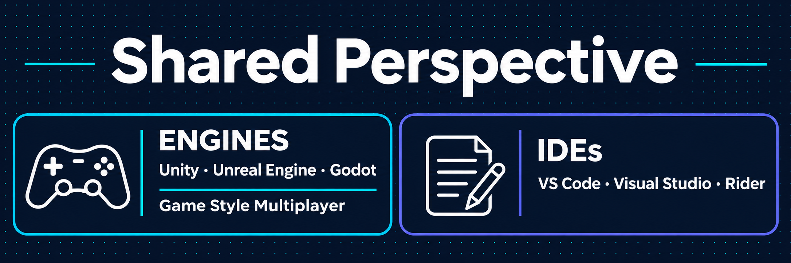
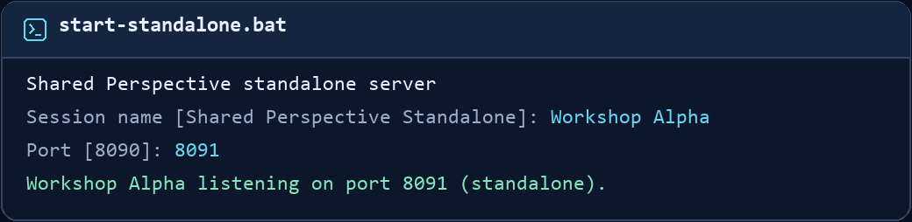
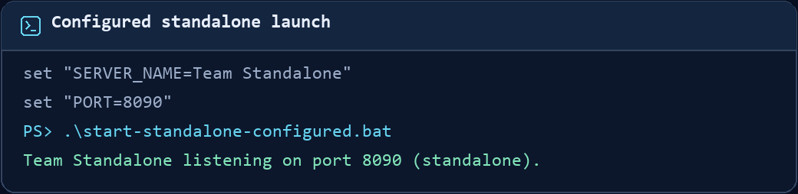

# 

Shared Perspective hosts a common WebSocket session for IDE and game engine adapters on Windows. The server, local coordinator, and terminal client provide the shared foundation for the adapter targets listed below. The server owns admission, identity, presence, chat and activity. Hosted sessions and their joined clients publish local discovery records. Adapter-specific events stay in their capability namespaces, and the binary scope is reserved for Game-Style Multiplayer.

## Set up on Windows

Install dependencies once from the repository root.

```powershell
npm ci
npm ci --prefix server
```

Run `npm run typecheck` and `npm test` to verify the checkout.

### Hosted sessions

Run `npm start` to host a session. The default port is `8080`. Set `SERVER_NAME` and `SERVER_PASSWORD` as needed. Set `PORT=0` to use an available port. Hosted sessions publish a local discovery record.

### Standalone servers

A standalone instance runs as its own process with its own session and port. You can run several on one machine alongside hosted sessions. Starting or stopping one affects only that instance. Use a different port for each server. If a port is already in use, the new instance exits and the existing server keeps running.

**Start interactively**

1. Double-click `start-standalone.bat`, or run `.\start-standalone.bat` from the repository root.
2. Enter a session name and port. Press Enter at either prompt to use its default. The standalone port defaults to `8090`. Enter `0` to let Windows assign an available port.
3. Connect using the machine's address and the port printed in the terminal. On the server machine, you can use `127.0.0.1`. Press Ctrl+C in that server's window to stop it.



**Start without prompts**

1. Copy `start-standalone.example.bat` to a new `.bat` file in the repository root. Keep the copy beside the original so it can find the `server` folder.
2. Edit the `SERVER_NAME` and `PORT` lines. Make a separate copy with a different port for each instance. Set `SERVER_PASSWORD` or `SHARED_PERSPECTIVE_SCOPES_FILE` in the launch environment if needed.
3. Run the configured copy. It starts immediately and stays in the foreground. You can also use `npm run standalone` with the same environment variables.



Standalone servers use direct addresses and stay out of hosted discovery. Clients can save them as favorites. After one app joins, other apps on that machine can use **Join Current Session**. Leaving the session disconnects local clients. The standalone server keeps running until you stop its process.

### Join from a client

In another terminal, run:

```powershell
npm run client -- --discover
npm run client
npm run client -- --url ws://192.168.1.20:8080
npm run client -- --session <session-id>
```

The terminal client shows the active local session or prompts for a server. Use `join` to join the active session. Start the first connection using `--url`, `--session`, the `HOST` and `PORT` environment variables, or the interactive `join` command. Set `SERVER_PASSWORD` in the first terminal if the selected session requires it. Type `favorites` or `visited` to list saved servers, then `join favorite <number>` or `join visited <number>` to select one.

## Discovery contract for adapters

1. Read JSON records directly under `%LOCALAPPDATA%\Shared Perspective\sessions` on Windows. On other platforms, use `$XDG_DATA_HOME/Shared Perspective/sessions` or `~/.local/share/Shared Perspective/sessions` when the variable is unset. `SHARED_PERSPECTIVE_DISCOVERY_DIR` overrides the directory for every app.
2. A hosted server publishes `<sessionId>.json` containing `{"version":1,"sessionId":"<UUID>","port":12345}` after binding. Use loopback for that port and remove the file when the host shuts down. The port must be an integer from 1 to 65535, and the session ID must match the filename.
3. After an accepted join to a hosted server, a client publishes `joined-<connectionId>.json`, with a newly generated connection UUID, in the same directory.

   ```json
   {"version":1,"connectionId":"<UUID>","sessionId":"<UUID>","url":"ws://teammate:8080","expiresAt":1800000000000}
   ```

   The joined record carries the actual server endpoint used by the app. Use lowercase UUIDs and an absolute `ws://` or `wss://` URL without credentials, a query, or a fragment. `expiresAt` is UTC Unix time in milliseconds, at most 30 seconds in the future. Write to a temporary file and atomically rename it into place. Refresh about every 10 seconds while the connection responds to a heartbeat. Remove only your connection's file on disconnect. A crash or lost connection lets that file expire. Never write session passwords or identity keys to discovery records.

4. Skip invalid, expired, or incomplete records. For each distinct session ID and URL, open a short WebSocket probe and check for `session.info` with route `sender` and the matching `data.sessionId`. Read the name, password requirement, and client count from that reply and close the probe. Display one live result per session ID, preferring the host's loopback endpoint if both kinds of record are present.
5. A selected app opens its own connection to the discovered endpoint. Verify the session ID again on that connection before sending `session.join`. Each successful join can keep the session discoverable for additional local apps, even after the app that found it first disconnects.

The TypeScript CLI uses the same file contract for both publication and discovery. IDE and engine adapters can implement the contract directly in their own language. A server advertises its mode in the optional session.info data field `mode` (`hosted` or `standalone`). Treat a missing mode as hosted. For standalone sessions, skip discovery publication and keep the normal connection heartbeat.

## Users and the shared local profile

A user is a participant in a session. The server assigns a session-level `userId` and keeps a shared username, optional session color, kind (`human` or `agent`), and aggregate activity. Each connection gets a separate `clientId` and declares its `ownerApp` (for example, `unity`, `visual-studio`, or `rider`). The same private identity key links apps to one user. Agent connections can supply their own key and use their own local profile if desired.

The TypeScript `SharedClient` handles discovery, joining, and maintaining the grouped roster. Read `localUser` or `users` after `rosterChanged`. Each `User` exposes `clients` and `getClientsByApp(ownerApp)`. Use `setActivity` to send app activity and `updateProfile` to edit the shared username or session color. In the CLI, run `users` to see the grouped roster. The `profile`, `username`, `color`, `favorite-color`, `pref`, `visited`, `favorites`, `favorite`, and `unfavorite` commands exercise the local settings.

### Cross-language adapter contract

- Send `session.join` with `username`, `ownerApp`, and optionally `color`, `participantKind`, and `identityKey`. The legacy `displayName` field is still accepted. The server publishes app connections using the existing `presence.list`, `presence.join`, and `presence.leave` events. Group by `userId` and key each app by `clientId`. `activity.state` updates the user's activity. Relayed JSON carries both `sourceUserId` and `sourceClientId`.
- Follow `user.profile` messages to update the grouped username and color. A joined app can send `user.profile.update` to the server with `username` and/or `color`. Use a null color to clear it. A separate connection joining an existing user inherits that user's current session profile.
- Every local app can read and edit the same profile under `%LOCALAPPDATA%\Shared Perspective\profile` by default on Windows, or next to the discovery directory on other platforms. `SHARED_PERSPECTIVE_PROFILE_DIR` overrides that location. Use atomic writes to individual UTF-8 JSON files. `username.json`, `color.json`, and `favoriteColor.json` hold independent optional string values. Both colors use `#RRGGBB`. The session color may appear in a join and is shown to peers. Favorite color is a private local preference and is never included in the join.
- `identity.json` contains a private 32-byte random secret as a lowercase hex JSON string. Create it once using exclusive file creation. If another app is still writing the secret, retry reading the incomplete JSON briefly. Human adapters derive the session key as HMAC-SHA256 of the UTF-8 session ID with the decoded secret bytes as the key, encoded as lowercase hex. A session-scoped key goes in the join. The local secret stays on the machine.
- Preference names use lowercase letters, digits, periods, underscores, and hyphens, start with a letter, and are at most 64 characters. Each preference is a JSON value under `preferences/<hex-encoded UTF-8 name>.json`. Accessors read current data from disk. Separate files let different apps edit different settings concurrently.
- Visiting and favoriting are independent. After a successful join, write `visited/<sha256-of-normalized-endpoint>.json` with `url`, `sessionId`, `name`, and `visitedAt` (UTC Unix milliseconds). Store explicit favorites under `favorites` with the same key and fields except `visitedAt`. Normalize a root endpoint without a trailing slash. The endpoint key allows revisits to survive a session restart. The local lists carry no passwords.

## Intended adapter targets

| Adapter | Owner app | Workspace capability |
|---|---|---|
| VS Code | `vscode` | `code` |
| Visual Studio | `visual-studio` | `code` |
| Rider | `rider` | `code` |
| Unity | `unity` | `engine.unity` |
| Unreal | `unreal` | `engine.unreal` |
| Godot | `godot` | `engine.godot` |
| Game Style Multiplayer for Unity | `game-style` | `gamestyle.multiplayer` |

Unity and Game Style use separate connections and capabilities. Either can join independently. When they run under the same local identity, both appear under the same session user. Each IDE or engine adapter owns its event payloads. Shared Perspective routes them without interpreting editor selections, file operations, scene objects, or gameplay state.

## Workspace scopes

Chat, identity, presence, and activity are session-wide. The server requires a workspace scope for any `code.*`, `engine.unity.*`, `engine.unreal.*`, `engine.godot.*`, or `gamestyle.multiplayer.*` relay. The host assigns a positive unsigned 32-bit ID to each project or workspace. A message routes only when both connections have been granted the message's namespace in that exact scope.

Set `SHARED_PERSPECTIVE_SCOPES_FILE` to a host-owned JSON file before starting the server. The server reads it at startup. Each entry grants one token access to the listed capabilities in one scope. A scope can have several entries, for example to issue separate Unity and Game Style grants. A token must be unique in the file and contain 32 to 128 URL-safe characters. Generate tokens from cryptographically random bytes and provide each adapter only the grants it needs.

```json
[
  { "scopeId": 70001, "token": "<random-engine-token>", "capabilities": ["engine.unity"] },
  { "scopeId": 70001, "token": "<random-game-style-token>", "capabilities": ["gamestyle.multiplayer"] },
  { "scopeId": 70002, "token": "<random-godot-token>", "capabilities": ["engine.godot"] }
]
```

For a scoped connection, look for `scopeProtocolVersion: 1` in `session.info`. Include `scopeGrants: [{ "scopeId": 70001, "token": "…" }]` in `session.join` alongside the adapter's capabilities. Use one grant per scope per connection. The server intersects the grant's capabilities with the adapter's declared capabilities. The successful join result lists granted `scopeIds`. A rejected grant rejects the join, so a session-only client can omit grants and join for chat. Grants are sent only during admission and are excluded from discovery records, profiles, and rosters. Send remote grants over a trusted connection, such as a TLS-enabled WebSocket endpoint.

Set `scopeId` on every workspace JSON event. The host checks it for sends, broadcasts, and targets. On a reconnect, request the grants again. Session admission, the visible user ID, and the workspace token have separate purposes. Sharing a user ID across app connections leaves each connection responsible for obtaining its own grants.

### Game Style binary layout

Game Style binary traffic uses the same grants as its JSON namespace. Version 2 replaces the original one-byte binary scope. The host rejects earlier binary frames.

| Offset | Size | Field |
|---:|---:|---|
| 0 | 1 | Version, currently `2` |
| 1 | 1 | Route, `1` others, `2` all, or `3` target |
| 2 | 4 | Target client ID, unsigned little-endian, used for target route |
| 6 | 4 | Source client ID, unsigned little-endian, set by the server |
| 10 | 4 | Workspace scope ID, unsigned little-endian |
| 14 | Remaining | Game Style payload |

### Adapter verification

An adapter should verify the session ID, join with its app owner and capabilities, consume the roster, send and receive session chat, and verify scoped send, receive, and rejection cases against the server. The core tests cover a shared identity across app connections, Godot scope isolation, separate Unity and Game Style permissions, and binary scoping. First contact from another machine currently requires a known server address. The local discovery registry handles the handoff to other apps after a connection joins.

## Local session controls for Windows adapters

Run one coordinator per signed-in Windows user. Start it with `npm run coordinator` when no service is listening. The terminal client launches it on demand. Keep one pipe connection open for each running app instance, including apps that have yet to join the remote session. The coordinator closes the session after the last local app closes and shuts down after five seconds with no registered apps.

| State | Adapter action |
|---|---|
| `idle` | Offer IP and port, Favorites, or Recently Visited. Send `join` with the chosen URL. |
| `joining` | The first app has reserved the session while the remote server processes its join. Wait for the next state. |
| `active`, this app idle | Offer **Join Current Session** and **Leave Session**. Send `join` without a URL to use the current endpoint. |
| `active`, this app joined | Show the session name and **Leave Session**. App close only releases that app. |
| `active`, this app reconnecting | Keep the current session selected while the coordinator retries. |
| `leaving` | Wait for all local connections to close before offering a new server. |

Closing a local app means closing its pipe. The coordinator holds the last remote connection if other adapters are still open and have yet to join. The remote roster can show the last app until another app joins or all apps close. A manual leave request from any open app closes the entire local session and cancels pending joins and retries. The remote host and other machines are unaffected.

Each app has its own remote client ID and capabilities. The coordinator keeps the active session password in memory for subsequent joins. Workspace grants still come from the individual adapter. Reconnect uses the original session ID, reuses that adapter's own admission options, and waits 250 ms, 500 ms, 1 second, 2 seconds, then 4 seconds between attempts. Admission failures stop retries. The adapter should rebuild presence and request any workspace state it needs after rejoining.

### Local IPC v1

Use UTF-8 JSON objects terminated by `\n` over the Windows named pipe. The local IPC version is independent of the remote scope protocol. Read the profile identity secret as documented above. Compute the IPC key as HMAC-SHA256 of the UTF-8 string `shared-perspective-local-session-v1` with that decoded secret. Take the SHA-256 digest of the lowercase hex IPC key as UTF-8, and use its first 32 lowercase hex characters as the suffix of `\\.\pipe\shared-perspective-`.

1. App sends `{"type":"hello","version":1,"nonce":"<32 random bytes as lowercase hex>"}`.
2. Service responds with `{"type":"hello","version":1,"nonce":"<server nonce>","proof":"<hex proof>"}`. For the proof, compute HMAC-SHA256 with the **decoded IPC key** over the UTF-8 string `server:<app nonce>:<server nonce>`. Verify it before sending any admission data.
3. App sends `{"type":"authenticate","proof":"<hex proof>"}` using the same construction with `app:` instead of `server:`. The service replies with the initial `state` event.

Each request has an integer `id` and an `op`. Replies are `{"type":"result","id":1,"ok":true}` or carry `ok:false` and `reason`. A successful join command starts admission. Wait for the `joined` event before sending collaboration traffic.

| Request | Example |
|---|---|
| Join current session | `{"id":1,"op":"join","options":{"ownerApp":"godot","capabilities":["chat","activity"]}}` |
| Join first by address | `{"id":1,"op":"join","options":{"ownerApp":"vscode","url":"ws://192.168.1.20:8080","capabilities":["chat","activity"]}}` |
| Leave all local apps | `{"id":2,"op":"leave"}` |
| Send JSON | `{"id":3,"op":"send","message":{"type":"chat.message","route":"all","data":{"text":"Hello"}}}` |
| Send binary | `{"id":4,"op":"sendBinary","data":"<base64 WebSocket payload>"}` |

Event payloads are `state` with `{phase,app,server?}`, `joined` with `result`, `roster` with `users`, `message` with `message`, `binary` with base64 `data`, and `problem` with `reason`. They can arrive before a request reply. The complete event types are exported from `LocalSessionCoordinator.ts`. To verify an adapter, join from one process, open an unjoined second process, close the first, join from the second, and leave from a third. Repeat with two different server addresses racing for the first join and with a dropped connection before manual leave.

## Session and public user data

Both stores use case-sensitive string keys and opaque string values. A write creates a missing key and replaces an existing value. An empty string is a value. A null value removes the key. Missing keys return `undefined` in TypeScript. Adapters may parse the strings as JSON or expose the stores through native indexers.

| Store | Readers | Writers | Lifetime |
|---|---|---|---|
| Session data | All joined clients | All joined clients | Server memory. Clears after the last client leaves or when the server closes. A departing client clears its own cache. |
| Public user data | All joined clients | Connections admitted as the owning user | The Windows coordinator saves owner edits in `public-user-data.json` under the owner's local profile. Public keys are published when that user first joins a session. Their live entries disappear when their last connection leaves. |

Each store allows up to 64 keys. Keys are at most 128 UTF-8 bytes and must contain a non-whitespace character. Values are at most 4,096 UTF-8 bytes. The complete encoded entry array is limited to 32 KiB.

On a local adapter, read `client.sessionData.get(key)` or `client.getUserData(userId)?.get(key)`. Write with `setSessionData(key, value)` or `setUserData(key, value)`. The latter always targets the current user. The TypeScript remote client also exposes each roster user's map as `user.data`. Both clients expose data-change events. Reads reflect the latest server response. The local IPC reply indicates the request was sent. Watch for the server change event to confirm the live value.

For other languages, send `session.data.set` or `user.data.set` with route `server` and data `{"key":"scene","value":"warehouse"}`. The server includes `sessionData` as a `[[key,value],...]` array in a successful join when the store is nonempty. Existing users' nonempty data arrives as `user.data.snapshot` with `userId` and `entries` after presence. Live changes arrive as `session.data.changed` or `user.data.changed`, with `userId` additionally supplied by the server for user events. Raw clients may publish saved data in `JoinRequest.userData`. The coordinator handles persistence and publishing for local adapters. Regular local preferences remain separate and private.
